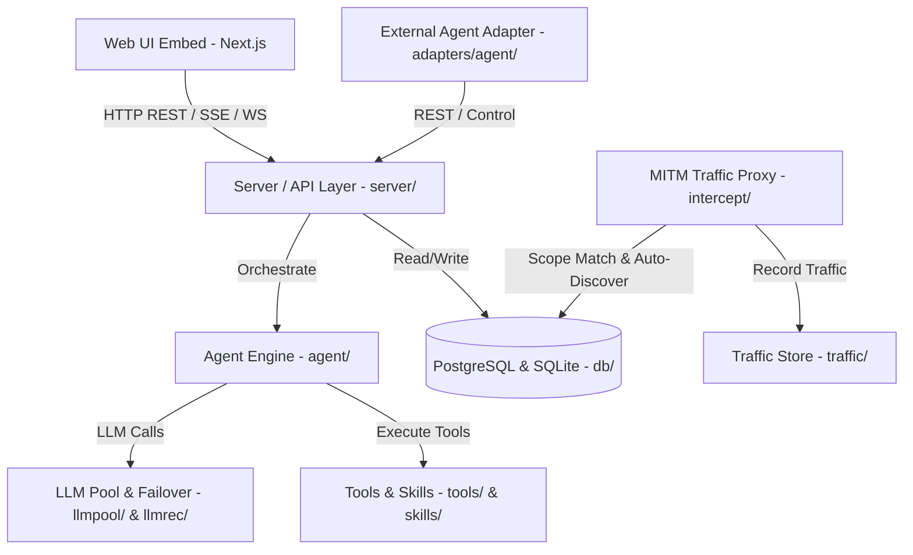
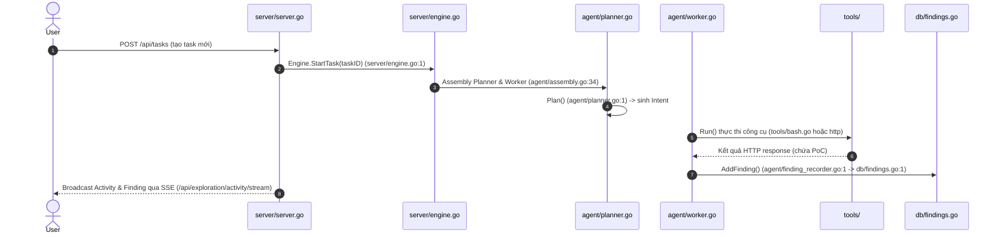

# ScopeWeaver (ARTEX) - System Architecture Document

*Ngày tạo: 15/10/2026*  
*Nguồn khảo sát: ScopeWeaver codebase (`github.com/Autumn-27/artex`) qua `codegraph` và phân tích mã nguồn trực tiếp.*

---

## 1. Tổng quan Kiến trúc

ScopeWeaver (`github.com/Autumn-27/artex`) được xây dựng theo mô hình **Monolith mô-đun hóa (Modular Monolith)** bằng ngôn ngữ Go (Go 1.26.3). Hệ thống là một nền tảng tự khởi tạo và vận hành nghiên cứu an ninh mạng / kiểm thử xâm nhập tự động (Autonomous AI penetration testing system).

Hệ thống đóng gói toàn bộ backend daemon, engine lập kế hoạch/thực thi agent, HTTP MITM Proxy bắt giữ lưu lượng traffic, và giao diện Web UI (Next.js / shadcn/ui) được nhúng trực tiếp vào một file binary Go duy nhất thông qua `go:embed`.

---

## 2. Entry Points chính

- **CLI Daemon Entry Point**: `cmd/artex/main.go:48` (`func run()`)
  - Khởi tạo flags (`-addr`, `-data`, `-proxy`), nạp cấu hình (`config/`), khởi động database manager (`server.NewManager`), xử lý nâng cấp binary tự động (`selfupdate.Bootstrap`) và lắng nghe tín hiệu OS shutdown.
- **HTTP REST / SSE / WebSocket API Entry Point**: `server/server.go:656` (`func (s *Server) Handler()`)
  - Lắng nghe cổng `:8787`, thiết lập middleware Auth JWT (`server/auth.go:1`), định tuyến REST APIs (`/api/tasks`, `/api/findings`, `/api/assets`, `/api/llm/*`), xử lý stream hoạt động thời gian thực (SSE/WS) và phục vụ static assets cho Web UI (`server/webui_embed.go:1`).
- **External Agent Adapter Entry Point**: `adapters/agent/`
  - Adapter kết nối cho phép các công cụ AI CLI ngoài (Claude Code, Codex, Pi) điều khiển tác vụ và quản lý kết quả kiểm thử.
- **Traffic Interception Proxy Entry Point**: `intercept/intercept.go:1`
  - Proxy MITM dựa trên `go-mitmproxy` lắng nghe cổng proxy (`127.0.0.1:8788`), can thiệp lưu lượng HTTP/HTTPS, đối chiếu bộ lọc DSL và lưu vết tài nguyên.

---

## 3. Layering & Tổ chức Module

1. **CLI Layer (`cmd/artex/`)**: Khởi tạo tiến trình daemon, xử lý tham số dòng lệnh và vòng đời ứng dụng.
2. **Server & API Layer (`server/`)**: Cung cấp REST APIs, JWT Auth Middleware, Manager (`server/manager.go`), Scheduler (`server/scheduler.go`), Notifier (`server/notifier.go`), Broadcaster thời gian thực.
3. **Agent Engine Layer (`agent/`)**:
   - `Planner` (`agent/planner.go`): Lập kế hoạch và định hướng nhánh kiểm thử.
   - `Worker` (`agent/worker.go`): Thực thi công cụ (tools), chạy lệnh shell, gửi HTTP request và ghi nhận quan sát.
   - `Assembly` (`agent/assembly.go`): Lắp ráp công cụ, prompts override, skills và MCP.
   - `ChatAgent` & `MainAgent`: Xử lý luồng hội thoại và các lượt tương tác chính.
4. **LLM Layer (`llmpool/`, `llmrec/`)**: Trừu tượng hóa nhà cung cấp LLM, hỗ trợ failover chain, giới hạn rate limit và ghi nhận usage/cost.
5. **Traffic Interception Layer (`intercept/`, `traffic/`)**: Bắt giữ lưu lượng HTTP/HTTPS, đối chiếu DSL quy tắc tài nguyên (`db/asset_dsl.go`), tự động cập nhật tài sản vào Company Scope.
6. **Persistence Layer (`db/`)**:
   - **PostgreSQL (`db/schema.sql`)**: Lưu trữ các thực thể chính (Agents, Tasks, Findings, Companies, Assets, Prompts, LLM Profiles).
   - **SQLite (`modernc.org/sqlite`)**: Lưu trữ log ngắn hạn, minh chứng (evidence), traffic log và transcript.

---

## 4. Domain Model / Thành phần Cốt lõi

- **`Task` (`server/server.go` & `db/db.go:1`)**: Tác vụ kiểm thử an ninh. Chứa trạng thái (`created`, `running`, `paused`, `done`), phạm vi asset đính kèm, danh sách chạy và lịch sử.
- **`Finding` (`db/findings.go:1`)**: Lỗ hổng / phát hiện an ninh mạng được ghi nhận. Chứa phân loại `vulnclass`, `severity` (Critical, High, Medium, Low), `evidence` (PoC HTTP request/response), trạng thái retest.
- **`Company` & `Asset` (`db/companies.go:1`, `db/assets.go:1`)**: Mục tiêu được phép kiểm thử (Domain, IP, CIDR, URL) với kiểm soát ranh giới an toàn nghiêm ngặt (`db/company_scope.go:1`).
- **`Agent` & `Prompt` (`agent/prompt.go:1`, `db/db.go:1`)**: Cấu hình Agent AI (Planner / Worker), định nghĩa prompt templates, ngân sách số lượt suy luận (wrapup max turns), và danh sách công cụ được cấp phép.

---

## 5. Chức năng Kỹ thuật chính

1. **Quản lý & Điều phối Tác vụ (Task Management)**:
   - Route `POST /api/tasks` (`server/server.go:680` -> `s.createTask`): Tạo tác vụ mới.
   - Route `POST /api/tasks/batch/control` (`server/server.go` -> `s.controlTasksBatch`): Bắt đầu/Tạm dừng/Dừng hàng loạt tác vụ.
2. **Lập Kế hoạch & Thực thi Tự động (Planner & Worker Execution Loop)**:
   - `agent/planner.go:Plan()`: Lập lộ trình công việc và tạo các `Intent` node.
   - `agent/worker.go:Run()`: Nhận `Intent` mở, thực thi lệnh qua `tools/` và lưu kết quả.
3. **Quản lý Phát hiện Lỗ hổng (Findings Triage & Deepen/Retest)**:
   - Route `GET /api/findings` (`server/server.go` -> `s.listFindings`): Truy vấn lỗ hổng theo dạng bảng, nhóm task hoặc cây tài sản.
   - Route `POST /api/exploration/findings/{id}/deepen` (`server/server.go` -> `s.deepenFinding`): Tạo tác vụ phụ để AI đào sâu khai thác lỗ hổng.
   - Route `POST /api/findings/{id}/retest` (`server/server.go` -> `s.createFindingRetest`): Tái kiểm thử lỗ hổng.
4. **Bắt Giữ & Phân Tích Traffic Proxy**:
   - `intercept/proxy.go:1`: MITM Proxy tự động ghi nhận request/response và đối chiếu luật `db/asset_dsl.go`.

---

## 6. Luồng Dữ liệu Chính (1-2 Use Cases)

### Luồng Thực thi Task & Ghi nhận Lỗ hổng (Hop-by-Hop Trace)

1. người dùng gọi `POST /api/tasks` (`server/server.go:680`).
2. Server chuyển lệnh sang Engine `Engine.StartTask()` (`server/engine.go:1`).
3. Engine gán bộ đôi `Planner` (`agent/planner.go`) và `Worker` (`agent/worker.go`).
4. `Planner` phân tích mục tiêu và sinh ra các `Intent` node.
5. `Worker` nhận `Intent` và thực thi công cụ trong `tools/` (ví dụ gửi HTTP request).
6. Khi phát hiện lỗi, `finding_recorder.go` gọi `db/findings.go:AddFinding()` để lưu bằng chứng PoC.
7. Sự kiện được phát thời gian thực về Web UI qua SSE (`server/broadcast.go`).

---

## 7. Thư viện Phụ thuộc Ngoài

- **Cơ sở dữ liệu**: PostgreSQL (`github.com/jackc/pgx/v5`), SQLite (`modernc.org/sqlite`).
- **HTTP MITM Proxy**: `github.com/lqqyt2423/go-mitmproxy`.
- **LLM/Tools Abstraction**: `github.com/Autumn-27/norma`.
- **Xác thực JWT**: `github.com/golang-jwt/jwt/v5`.
- **Phân tích DNS**: `github.com/miekg/dns`, `github.com/projectdiscovery/dnsx`.

---

## 8. Pattern & Convention Đáng Chú Ý

- **Embedded Executable**: Phân phối duy nhất 1 binary Go tích hợp sẵn toàn bộ frontend Next.js qua `go:embed`.
- **Self-Updating Binary**: Tự động thay thế file binary khi nâng cấp và sử dụng exit code `75` (`ExitRestart`) để supervisor script khởi động lại binary mới.
- **Strict Target Scope Guard**: Module `db/company_scope.go` kiểm tra phạm vi tài sản cho phép trước khi AI thực thi bất kỳ công cụ quét nào, đảm bảo không quét nhầm mục tiêu ngoài phạm vi.
